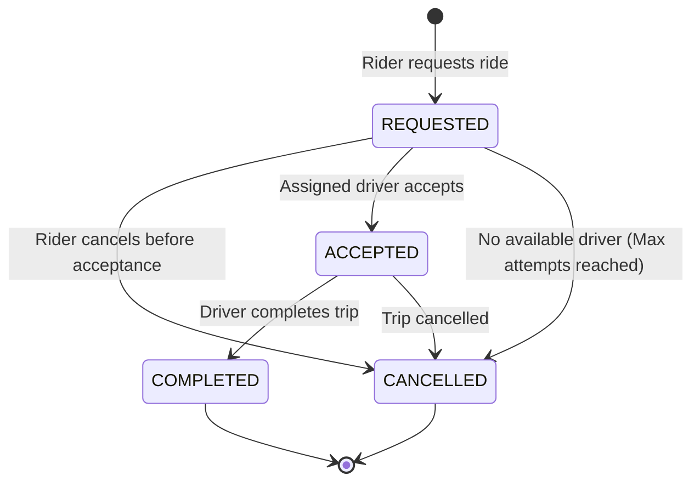
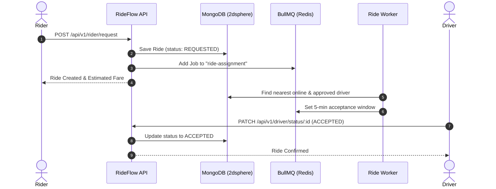

# RideFlow API 🚖

[](https://rideflow-ride-booking-system-backend.onrender.com/)
[](https://nodejs.org/)
[](https://www.typescriptlang.org/)
[](https://expressjs.com/)
[](https://www.mongodb.com/)
[](https://redis.io/)

> **RideFlow** is a production-ready, scalable, and role-based backend engine for on-demand ride booking platforms. Built with **Node.js**, **Express.js**, **TypeScript**, **MongoDB**, **Redis**, and **BullMQ**, it features geospatial driver matching, automated queue-based dispatching, dynamic fare calculation, and fine-grained role-based access control.

---

## 🌐 Live API

- **Base URL:** [https://rideflow-ride-booking-system-backend.onrender.com/](https://rideflow-ride-booking-system-backend.onrender.com/)
- **API Version 1 Endpoint:** `https://rideflow-ride-booking-system-backend.onrender.com/api/v1`
- **Health Check / Welcome:** `GET /` &rarr; `Welcome to RideFlow API`

---

## 📑 Table of Contents

- [Live API](#-live-api)
- [Key Features](#-key-features)
- [System Architecture & Ride Lifecycle](#-system-architecture--ride-lifecycle)
- [Tech Stack](#-tech-stack)
- [Project Directory Structure](#-project-directory-structure)
- [Geospatial & Dynamic Fare Engine](#-geospatial--dynamic-fare-engine)
- [API Reference](#-api-reference)
  - [Authentication (`/api/v1/auth`)](#authentication-apiv1auth)
  - [Users Management (`/api/v1/user`)](#users-management-apiv1user)
  - [Drivers (`/api/v1/driver`)](#drivers-apiv1driver)
  - [Riders (`/api/v1/rider`)](#riders-apiv1rider)
  - [Rides Administration (`/api/v1/ride`)](#rides-administration-apiv1ride)
- [Environment Configuration](#-environment-configuration)
- [Getting Started](#-getting-started)
- [Business Rules & Validation](#-business-rules--validation)
- [Future Improvements](#-future-improvements)
- [Author & License](#-author--license)

---

## ✨ Key Features

### 🔐 Authentication & Role-Based Access Control (RBAC)
- Multi-role authorization: `SUPER_ADMIN`, `admin`, `rider`, and `driver`.
- JWT-based authentication using HTTP-only cookies (`refreshToken`) and bearer authorization.
- Password hashing with `bcryptjs`.
- Automatic **Super Admin seeding** on server initialization.

### 🚗 Driver Management
- Dedicated driver profile registration with vehicle details.
- Real-time driver online/offline availability toggle.
- MongoDB `2dsphere` geospatial live location updates.
- Driver dashboard for viewing assigned ride requests, completed trip history, and cumulative earnings.
- Administrative approval workflow (`pending` &rarr; `approved` / `rejected` / `suspended`).

### 📱 Rider Features
- Instant ride booking specifying pickup and destination coordinates/addresses.
- Automated distance computation and transparent upfront fare calculation.
- Ride cancellation support (available prior to driver acceptance).
- Comprehensive trip history tracking.

### ⚡ Automated Queue-Based Dispatch Engine (BullMQ + Redis)
- Asynchronous matching pipeline powered by **BullMQ** workers (`ride-assignment`).
- **Proximity-First Matching:** Dispatches rides to nearest online, approved, and currently available drivers within proximity using MongoDB `$near` queries.
- **Retry Mechanism:** Configured with fallback retries (up to 4 attempts) with automated driver state tracking via Redis sets if a driver fails to respond or accept within timeout thresholds.

---

## 🔄 System Architecture & Ride Lifecycle

### Ride State Transitions



### BullMQ Ride Assignment Flow



---

## 🛠 Tech Stack

| Category | Technologies |
| :--- | :--- |
| **Runtime & Language** | [Node.js](https://nodejs.org/) (v18+), [TypeScript](https://www.typescriptlang.org/) (v5.x), [tsx](https://github.com/privatenumber/tsx) |
| **Web Framework** | [Express.js](https://expressjs.com/) (v5.x) |
| **Database & ODM** | [MongoDB](https://www.mongodb.com/), [Mongoose](https://mongoosejs.com/) (v9.x) with 2dsphere GeoJSON indexes |
| **Caching & Job Queue** | [Redis](https://redis.io/) via [ioredis](https://github.com/redis/ioredis), [BullMQ](https://docs.bullmq.io/) (v5.x) |
| **Security & Auth** | JSON Web Token (`jsonwebtoken`), `bcryptjs`, `cookie-parser`, `cors`, `express-session` |
| **Data Validation** | [Zod](https://zod.dev/) schema validations |
| **Deployment** | [Render](https://render.com/) |

---

## 📂 Project Directory Structure

```text
RideFlow-ride-booking-system-backend/
├── src/
│   ├── app/
│   │   ├── config/              # Environment variables & Redis client configuration
│   │   │   ├── config.ts
│   │   │   └── redis.ts
│   │   ├── interfaces/          # Global TypeScript typings
│   │   │   └── index.d.ts
│   │   ├── middleware/          # Express middlewares (Auth, Validation, Error Handling)
│   │   │   ├── checkAuth.ts
│   │   │   ├── globalErrorHandler.ts
│   │   │   ├── notFound.ts
│   │   │   └── validateRequest.ts
│   │   ├── modules/             # Domain-driven feature modules
│   │   │   ├── auth/            # Authentication & session controllers/services
│   │   │   ├── driver/          # Driver profiles, availability, and earnings
│   │   │   ├── ride/            # Ride model, worker, and BullMQ queue
│   │   │   ├── rider/           # Ride booking & rider actions
│   │   │   └── user/            # User schemas, profiles & admin controls
│   │   ├── routers/             # Centralized route aggregator
│   │   │   └── index.ts
│   │   └── utils/               # Helpers, Fare calculations & Worker runner
│   │       ├── AppError.ts
│   │       ├── catchAsync.ts
│   │       ├── fareCalculationHelpers.ts
│   │       ├── jwt.ts
│   │       ├── queryBuilder.ts
│   │       ├── seedSuperAdmin.ts
│   │       ├── sendCookie.ts
│   │       ├── sendResponse.ts
│   │       └── startWorker.ts
│   ├── app.ts                   # Express application setup & middleware pipelines
│   └── server.ts                # App initialization, DB connection, & workers
├── .env.example                 # Example environment variables
├── eslint.config.mjs            # ESLint configuration
├── package.json                 # Project dependencies & scripts
├── tsconfig.json                # TypeScript compiler config
└── README.md                    # Project documentation
```

---

## 📍 Geospatial & Dynamic Fare Engine

### 1. GeoJSON Format
Locations for drivers, pickups, and destinations are stored in standard MongoDB **GeoJSON Point** format:

```json
{
  "type": "Point",
  "coordinates": [90.4125, 23.8103]
}
```
> **Note:** Longitude (`coordinates[0]`) comes **first**, followed by Latitude (`coordinates[1]`).

### 2. Haversine Distance Formula
Distance between pickup and destination coordinates is computed using the Great-Circle Haversine calculation:

$$\Delta\sigma = 2 \cdot \arcsin\left(\sqrt{\sin^2\left(\frac{\Delta\phi}{2}\right) + \cos(\phi_1)\cos(\phi_2)\sin^2\left(\frac{\Delta\lambda}{2}\right)}\right)$$

$$d = R \cdot \Delta\sigma \quad (\text{where } R = 6371\text{ km})$$

### 3. Fare Structure

$$\text{Total Fare} = \text{Base Fare} + (\text{Distance in KM} \times \text{Per KM Rate})$$

- **Base Fare:** `50 BDT`
- **Rate Per KM:** `20 BDT`

*Example:* A trip of **12 km** calculates to:
$$\text{Fare} = 50 + (12 \times 20) = 290\text{ BDT}$$

---

## 📡 API Reference

Base URL for all endpoints: `/api/v1`

### Authentication (`/api/v1/auth`)

| Method | Endpoint | Access / Role | Description |
| :--- | :--- | :--- | :--- |
| `POST` | `/api/v1/auth/register` | Public | Register a new user (`rider` or `driver`) |
| `POST` | `/api/v1/auth/login` | Public | Authenticate user, receive JWT & HTTP-only cookie |
| `GET` | `/api/v1/auth/me` | Authenticated | Get current logged-in user profile |

<details>
<summary><b>View Sample Register Request & Response</b></summary>

```http
POST /api/v1/auth/register
Content-Type: application/json

{
  "name": "Jane Doe",
  "email": "jane@example.com",
  "password": "Password@123",
  "role": "rider",
  "phoneNumber": "+8801700000000",
  "address": "Dhaka, Bangladesh"
}
```

```json
{
  "statusCode": 201,
  "success": true,
  "message": "User created successfully",
  "data": {
    "_id": "6741b2a98f123456789abcde",
    "name": "Jane Doe",
    "email": "jane@example.com",
    "role": "rider",
    "isActive": "ACTIVE"
  }
}
```
</details>

---

### Users Management (`/api/v1/user`)

| Method | Endpoint | Access / Role | Description |
| :--- | :--- | :--- | :--- |
| `GET` | `/api/v1/user/me` | Authenticated | Get currently authenticated profile |
| `GET` | `/api/v1/user/get-all-users` | `SUPER_ADMIN`, `admin` | Retrieve all registered users |
| `PATCH` | `/api/v1/user/:id` | `SUPER_ADMIN`, `admin` | Update user status, role, or block/unblock |

---

### Drivers (`/api/v1/driver`)

| Method | Endpoint | Access / Role | Description |
| :--- | :--- | :--- | :--- |
| `POST` | `/api/v1/driver/profile` | `driver` | Create driver profile & vehicle information |
| `GET` | `/api/v1/driver/profile` | `driver`, `admin`, `SUPER_ADMIN` | Get driver profile details |
| `GET` | `/api/v1/driver/earnings` | `driver`, `admin`, `SUPER_ADMIN` | View driver total earnings |
| `PATCH` | `/api/v1/driver/availability` | `driver`, `admin`, `SUPER_ADMIN` | Toggle driver availability (`isOnline: true/false`) |
| `PATCH` | `/api/v1/driver/location` | `driver`, `admin`, `SUPER_ADMIN` | Update driver current GeoJSON coordinates |
| `GET` | `/api/v1/driver/request` | `driver` | Fetch assigned pending ride request |
| `GET` | `/api/v1/driver/rides-history`| `driver` | View history of rides assigned to driver |
| `PATCH` | `/api/v1/driver/status/:id` | `driver` | Update ride status (`ACCEPTED`, `COMPLETED`, `CANCELLED`) |
| `GET` | `/api/v1/driver` | `admin`, `SUPER_ADMIN` | Retrieve list of all drivers |
| `PATCH` | `/api/v1/driver/status/:id` | `admin`, `SUPER_ADMIN` | Approve, reject, or suspend a driver |

---

### Riders (`/api/v1/rider`)

| Method | Endpoint | Access / Role | Description |
| :--- | :--- | :--- | :--- |
| `POST` | `/api/v1/rider/request` | `rider` | Request a ride (triggers BullMQ driver matching) |
| `PATCH` | `/api/v1/rider/cancel/:rideId` | `rider` | Cancel ride request (allowed prior to driver acceptance) |
| `GET` | `/api/v1/rider/history` | `rider` | View ride booking history for the rider |

<details>
<summary><b>View Sample Ride Request Payload</b></summary>

```http
POST /api/v1/rider/request
Authorization: Bearer <JWT_TOKEN>
Content-Type: application/json

{
  "pickupLocation": {
    "type": "Point",
    "coordinates": [90.4125, 23.8103]
  },
  "pickupAddress": "Gulshan 1, Dhaka",
  "destinationLocation": {
    "type": "Point",
    "coordinates": [90.3994, 23.7771]
  },
  "destinationAddress": "Mohakhali DOHS, Dhaka"
}
```
</details>

---

### Rides Administration (`/api/v1/ride`)

| Method | Endpoint | Access / Role | Description |
| :--- | :--- | :--- | :--- |
| `GET` | `/api/v1/ride` | `admin`, `SUPER_ADMIN` | List all platform rides with filters and pagination |
| `GET` | `/api/v1/ride/:id` | `admin`, `SUPER_ADMIN` | Retrieve detailed information for a specific ride |

---

## ⚙️ Environment Configuration

Create a `.env` file in the root directory by referencing `.env.example`:

```bash
cp .env.example .env
```

| Variable | Description | Example |
| :--- | :--- | :--- |
| `PORT` | Application server listening port | `5000` |
| `MONGODB_URL` | MongoDB connection URI | `mongodb+srv://...` |
| `FRONTEND_URL` | Client origin URL for CORS policy | `http://localhost:5173` |
| `NODE_ENV` | Runtime environment mode | `development` / `production` |
| `BCRYPT_SALT_ROUNDS`| Salt rounds for password hashing | `10` |
| `JWT_SECRET` | Secret key for access token signing | `your_access_jwt_secret` |
| `JWT_EXPIRE` | Expiry duration for access token | `1d` |
| `JWT_REFRESH_SECRET`| Secret key for refresh tokens | `your_refresh_jwt_secret`|
| `JWT_REFRESH_EXPIRE`| Expiry duration for refresh tokens | `30d` |
| `SUPER_ADMIN_EMAIL` | Auto-seeded super administrator email | `admin@rideflow.com` |
| `SUPER_ADMIN_PASSWORD` | Auto-seeded super administrator password | `AdminPass@123` |
| `REDIS_HOST` | Redis server hostname or connection endpoint | `127.0.0.1` |
| `REDIS_PORT` | Redis server port number | `6379` |
| `REDIS_PASSWORD` | Redis authentication password | `your_redis_password` |

---

## 🚀 Getting Started

### Prerequisites
- [Node.js](https://nodejs.org/) v18.0.0 or higher
- [MongoDB](https://www.mongodb.com/) instance (local or Atlas)
- [Redis](https://redis.io/) server (local or Redis Cloud)
- [npm](https://www.npmjs.com/) package manager

### 1. Clone Repository

```bash
git clone https://github.com/your-username/RideFlow-ride-booking-system-backend.git
cd RideFlow-ride-booking-system-backend
```

### 2. Install Dependencies

```bash
npm install
```

### 3. Setup Environment Variables

```bash
cp .env.example .env
# Open .env and fill in your MongoDB, Redis, and JWT secrets
```

### 4. Run Development Server

```bash
npm run dev
```

### 5. Build & Run for Production

```bash
# Compile TypeScript to JavaScript
npm run build

# Start production server
npm start
```

---

## 🛡 Business Rules & Validation

1. **Rider Safeguards:**
   - Riders cannot hold multiple concurrent active rides.
   - Rides can only be cancelled while in the `REQUESTED` state.
2. **Driver Verification & Safety:**
   - Drivers must be marked `approved` by an Administrator before receiving ride dispatches.
   - Drivers must have `isOnline: true` and `isAvailable: true` to be matched.
   - Only the driver assigned to a ride can accept, complete, or update that ride's status.
3. **Account Enforcement:**
   - Blocked accounts (`isActive: BLOCK`) are denied access to protected platform routes.
4. **Queue Lifecycle:**
   - If an assigned driver does not accept within the timeout window, the ride assignment worker dynamically re-queues and finds the next closest driver.

---

## 🔮 Future Improvements

- [ ] Real-time two-way location tracking via **WebSockets / Socket.IO**
- [ ] Payment Gateway Integration (Stripe, SSLCommerz, bKash)
- [ ] In-app push notifications for ride events
- [ ] Surge pricing algorithm during high-demand hours
- [ ] Two-way rating & review system for riders and drivers
- [ ] Comprehensive analytics and revenue metrics dashboard

---

## 👨‍💻 Author & License

- **Author:** Asifur Rahman
- **License:** ISC
- **Repository:** [RideFlow Ride Booking System](https://github.com/your-username/RideFlow-ride-booking-system-backend)
- **Live Deployment:** [https://rideflow-ride-booking-system-backend.onrender.com/](https://rideflow-ride-booking-system-backend.onrender.com/)
